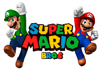
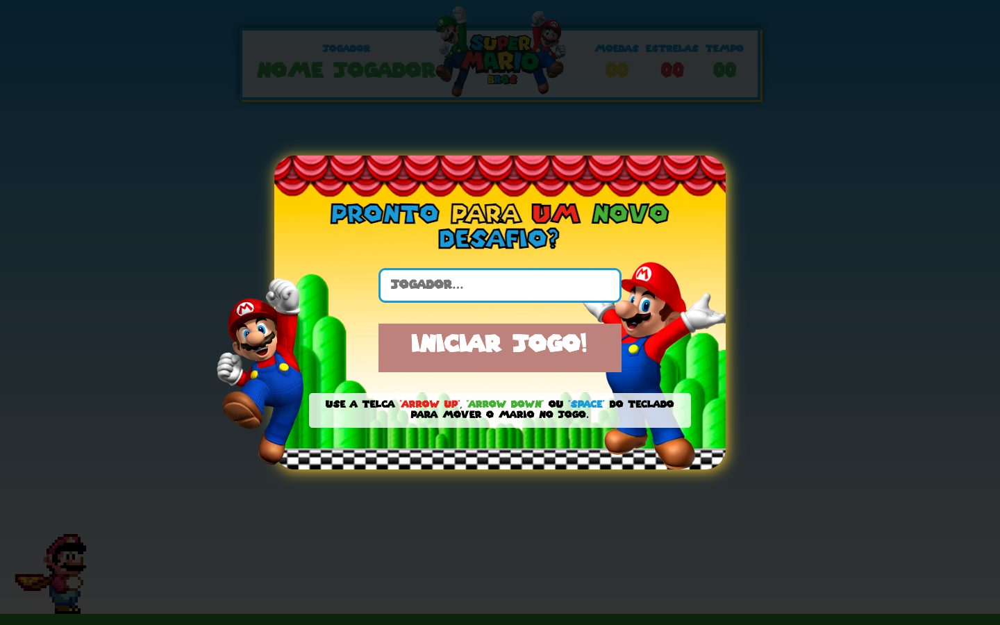
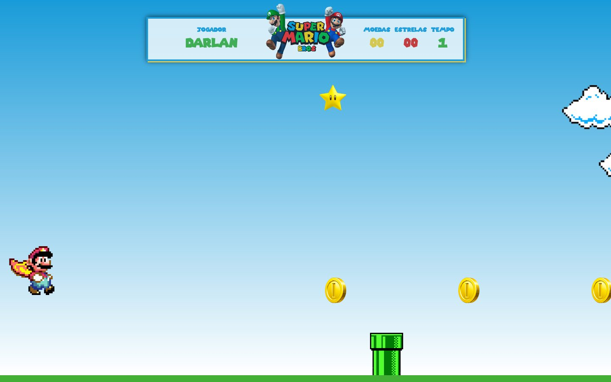
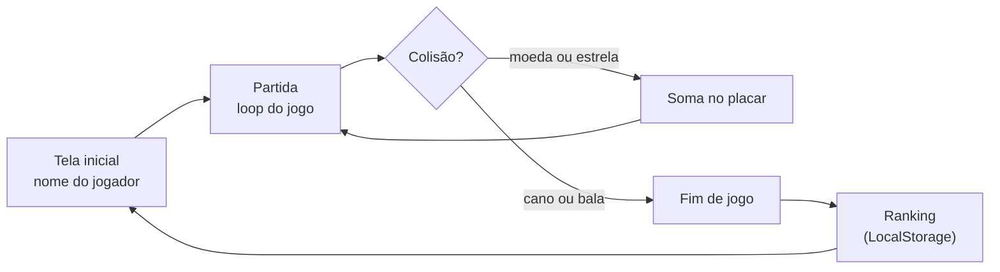

<div align="center">



# Jogo do Mario · edição YouTube

**A versão refeita e organizada do meu jogo do Mario, ensinada passo a passo numa série de 42 aulas no YouTube.**

[**▶ Assistir a série**](https://www.youtube.com/playlist?list=PLCNFRvVK1LVNXTnaPo6MReEwq75VA9WB5) · [Canal no YouTube](https://www.youtube.com/@DarlanPAraujo) · [Versão original de 2022 (jogável)](https://github.com/darlanaraujo/jogo-mario)


[](https://www.youtube.com/playlist?list=PLCNFRvVK1LVNXTnaPo6MReEwq75VA9WB5)

</div>

<table>
  <tr>
    <td width="50%"></td>
    <td width="50%"></td>
  </tr>
  <tr>
    <td align="center"><sub>Pronto para um novo desafio: nome do jogador e as teclas</sub></td>
    <td align="center"><sub>Em jogo: placar com moedas, estrelas e tempo</sub></td>
  </tr>
</table>

## A série no YouTube

<a href="https://www.youtube.com/playlist?list=PLCNFRvVK1LVNXTnaPo6MReEwq75VA9WB5"></a>

Este repositório é o código da série **[Mini-Projeto Jogo Mario - HTML, CSS e JS](https://www.youtube.com/playlist?list=PLCNFRvVK1LVNXTnaPo6MReEwq75VA9WB5)**, no canal
**[Darlan Araujo](https://www.youtube.com/@DarlanPAraujo)**: **42 aulas** construindo o jogo do zero, uma parte por vez, do cenário
ao ranking.

O canal nasceu para compartilhar programação com uma abordagem detalhada, porém simples, para quem, como eu na
época, estava começando.

<br clear="right">

## O que mudou em relação à versão de 2022

A [primeira versão](https://github.com/darlanaraujo/jogo-mario) funcionava, mas tinha toda a lógica num arquivo só.
Esta edição reescreve o jogo pensando em quem vai aprender com ele:

| | 2022 | 2023 (esta) |
|---|---|---|
| **JavaScript** | um arquivo com tudo | separado em módulos: jogo (`script.js`), utilidades (`modulos.js`) e dados (`conexao.js`) |
| **Estilos** | um SCSS único | partes por assunto: cores, animações e janela (`_padrao-cores`, `_animacoes`, `_modal`) |
| **Placar** | tempo e moedas | tempo, moedas, estrelas e **pontuação** |
| **Ranking** | os 10 melhores | os 10 melhores, guardados como uma pequena "base de dados" no navegador |

## Como se joga

| Tecla | O que faz |
|---|---|
| `↑` ou `Espaço` | Mario pula |
| `↓` | Mario se abaixa |

Desvie dos canos e da bala, pegue moedas e estrelas e aguente o máximo que puder: a velocidade aumenta com o tempo.

## Por dentro



- **`conexao.js`** guarda e lê os resultados no navegador, como se fosse um banco de dados simples.
- **`modulos.js`** reúne funções reaproveitáveis (sons, telas, placar).
- **`script.js`** cuida do loop, das colisões e da velocidade.

## Rodar

Por usar módulos JavaScript, o jogo precisa ser aberto por um servidor local (abrir o arquivo direto bloqueia os módulos):

```bash
# na pasta do projeto
python3 -m http.server 8000
# e abra http://localhost:8000
```

Ou use a extensão Live Server do VS Code.

## Autoria

Desenvolvido e ensinado por **[Darlan Araujo](https://www.youtube.com/@DarlanPAraujo)** em 2023, sem ferramentas de IA: cada linha
escrita à mão e explicada em vídeo.<br>
Super Mario é marca da Nintendo; personagens e sons usados apenas como homenagem, sem fins comerciais.
